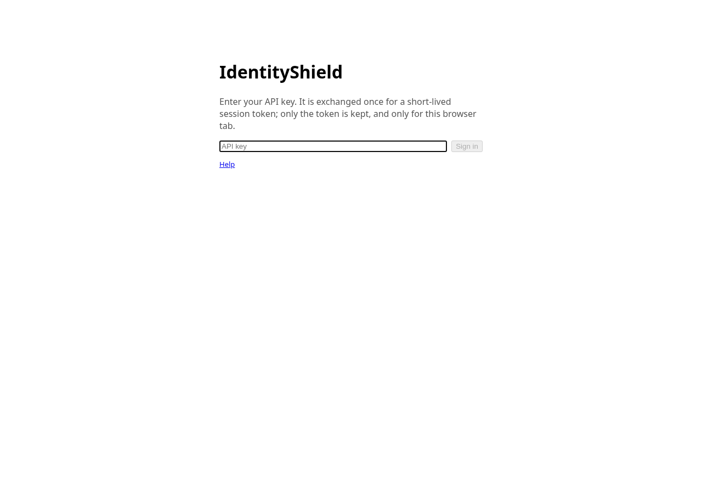
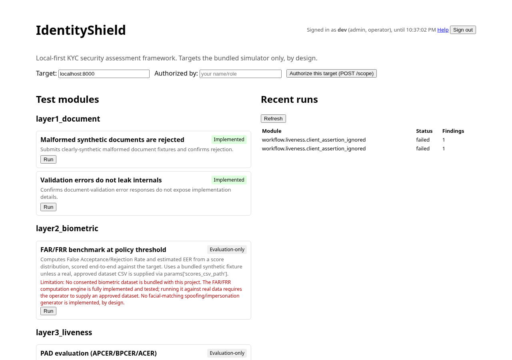
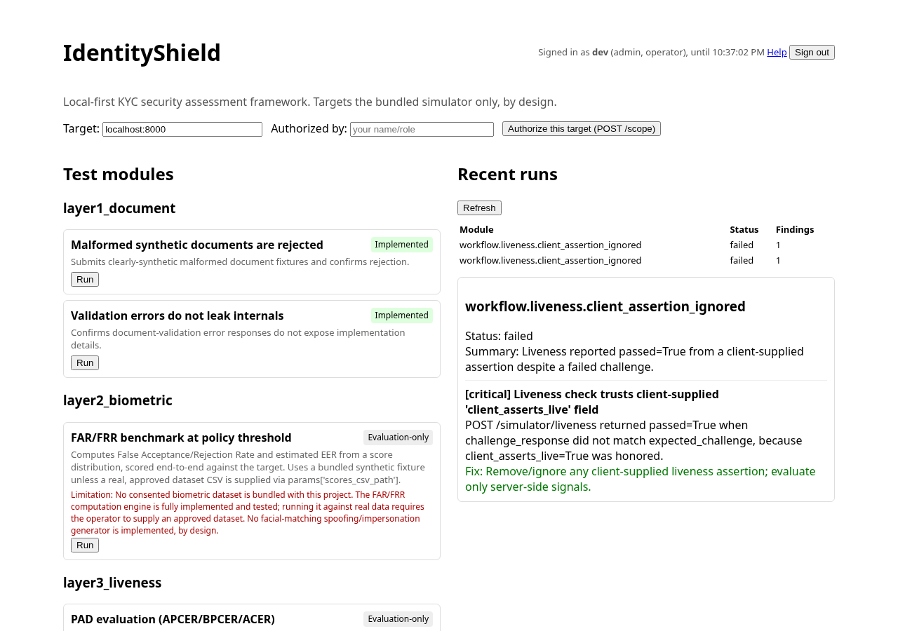
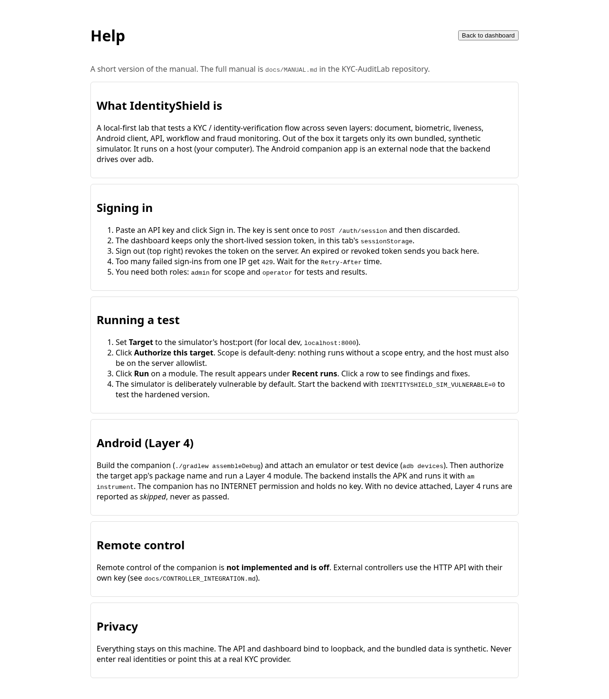

<p align="center"></p>

# IdentityShield user manual

This manual explains how to install, run and use IdentityShield in plain language. It covers what the
code in this repository does today. Where something is missing or only partly built, the manual says so.
For background, see [`ARCHITECTURE.md`](ARCHITECTURE.md), [`THREAT_MODEL.md`](THREAT_MODEL.md) and
[`LIMITATIONS.md`](LIMITATIONS.md).

Contents

1. [What IdentityShield is](#1-what-identityshield-is)
2. [Install and setup](#2-install-and-setup)
3. [Using every feature, step by step](#3-using-every-feature-step-by-step)
4. [Android permissions](#4-android-permissions)
5. [Fleet integration](#5-fleet-integration)
6. [Troubleshooting and FAQ](#6-troubleshooting-and-faq)
7. [Privacy and data handling](#7-privacy-and-data-handling)

---

## 1. What IdentityShield is

IdentityShield (repository name `KYC-AuditLab`) is a **local-first security lab** for KYC and
identity-verification systems. It checks how well a verification flow holds up across seven layers:

| Layer | ID | What it looks at |
|---|---|---|
| 1 | `layer1_document` | Document validation (malformed fixtures, error messages that leak details) |
| 2 | `layer2_biometric` | Face-match benchmarking (FAR/FRR on bundled synthetic scores, evaluation only) |
| 3 | `layer3_liveness` | Liveness / presentation-attack benchmarking (APCER/BPCER, evaluation only) |
| 4 | `layer4_android` | Android client security, via the companion app on an emulator or test device |
| 5 | `layer5_api` | API auth, cross-session isolation, input validation, rate limits |
| 6 | `layer6_workflow` | Verification workflow and session logic |
| 7 | `layer7_fraud` | Fraud monitoring (identity reuse, audit-trail completeness) |

Out of the box it tests **only its own bundled simulator**, a deliberately flawed, fully synthetic KYC
backend mounted at `/simulator` (like OWASP Juice Shop, but for KYC).

**Fleet role.** IdentityShield is a **host tool**: the backend, the dashboard and the CLI run on your
computer. The Android companion (`com.identityshield.companion`) is an **EXTERNAL_NODE**. It runs on a
separate emulator or test device, cannot reach the network, and only does something when the host's
backend drives it over `adb`.

What it is **not**: it doesn't test third-party production KYC providers, it doesn't generate deepfakes
or spoofing media, and it doesn't ship tools to bypass Play Integrity, hide root or defeat certificate
pinning (see `LIMITATIONS.md`).

---

## 2. Install and setup

### 2.1 Local development (no Docker)

You need Python 3.12 (3.x works; the test suite is checked on 3.12) and Node.js 20.

```bash
cd backend
python3 -m venv .venv && source .venv/bin/activate
pip install -r requirements.txt
export IDENTITYSHIELD_DEV_API_KEYS="dev:admin+operator:devkey"   # local dev only, see 3.2
uvicorn app.main:app --reload            # API on http://127.0.0.1:8000
```

In a second terminal:

```bash
cd dashboard
npm ci
npm run dev                              # dashboard on http://localhost:5173
```

The dashboard calls `http://localhost:8000` unless you set `VITE_API_BASE_URL` (a public build setting,
not a secret). The default local database is SQLite (`backend/identityshield.db`).

### 2.2 Docker Compose with Postgres

```bash
cp .env.example .env
# edit .env: set a strong POSTGRES_PASSWORD, IDENTITYSHIELD_API_KEYS (hashed, see 3.2)
# and IDENTITYSHIELD_SESSION_SECRET (at least 32 characters)
docker compose up --build
```

- The backend (`8000`) and dashboard (`5173`) are published on **`127.0.0.1` only**. Don't change that
  to all interfaces.
- Postgres isn't published on the host. Only the backend reaches it on the internal compose network.
- Compose refuses to start if `POSTGRES_USER` / `POSTGRES_PASSWORD` are unset. URL-encode the password
  if it contains `@ : / %`.
- In compose the allowlist is `backend,localhost,127.0.0.1`, so the dashboard's default target
  `backend:8000` works there.
- On PostgreSQL the backend adds missing enum labels at startup (for example `SKIPPED`). See the README
  section "Postgres enum migration".

### 2.3 Android companion: build, install, pair

"Pairing" here just means **connecting a device over adb**. The app has no account, no key, no network
pairing and no `INTERNET` permission.

1. Install JDK 17 or newer and an Android SDK with platform 36.
2. Build:
   ```bash
   cd android-companion
   ANDROID_HOME=/path/to/android-sdk ./gradlew assembleDebug
   # output: app/build/outputs/apk/debug/app-debug.apk
   ```
3. Start an emulator or connect a **test** device with USB debugging on. Accept the "Allow USB
   debugging" prompt, then check:
   ```bash
   adb devices        # the device must show as "device", not "unauthorized"
   ```
4. You don't need to install the APK yourself. When you run a Layer 4 module, the backend's harness
   runs `adb install -r -t <apk>` and then:
   ```bash
   adb shell am instrument -w -e target_package <pkg> \
       com.identityshield.companion/.IntegrityInstrumentation
   ```
   To install it manually anyway: `adb install -r app/build/outputs/apk/debug/app-debug.apk`.
5. The app's launcher icon (**IdentityShield Help**) only opens an offline Help screen. The checks run
   through `am instrument`, not through the UI.

The harness looks for the APK at the default build path, or at `IDENTITYSHIELD_COMPANION_APK`, or at
the `apk_path` run parameter.

---

## 3. Using every feature, step by step

### 3.1 The 7-layer test suite against the simulator

The simulator lives in the same server at `/simulator` (`/session`, `/document`, `/face`,
`/liveness/challenge`, `/liveness`, `/decision`, `/audit/{id}`; `/simulator/admin/reset` needs
`admin`).

- **Vulnerable mode (default).** `IDENTITYSHIELD_SIM_VULNERABLE` is unset or `true`. The simulator
  deliberately leaves in one class of flaw per layer, so the tests have something real to find.
- **Hardened mode.** Start the server with `IDENTITYSHIELD_SIM_VULNERABLE=0` (any value other than
  `true` turns it off). The same tests should then report the flaws as fixed.

Steps (using the dev key from 2.1):

1. **Authorize the target.** Scope is default-deny: a module runs only if the host is on the server
   allowlist (`IDENTITYSHIELD_ALLOWED_TARGETS`, default `localhost,127.0.0.1`) **and** has an active
   scope entry.
   ```bash
   curl -X POST localhost:8000/scope -H 'X-API-Key: devkey' \
        -H 'Content-Type: application/json' -d '{"target": "localhost"}'
   ```
2. **List modules:** `curl -H 'X-API-Key: devkey' localhost:8000/tests/modules`. Each module shows
   its layer and whether it is `implemented`, `evaluation_only` or a `stub_not_implemented`, plus any
   limitation.
3. **Run one module:**
   ```bash
   curl -X POST localhost:8000/tests/run -H 'X-API-Key: devkey' -H 'Content-Type: application/json' \
        -d '{"module_id": "workflow.liveness.client_assertion_ignored", "target": "localhost:8000"}'
   ```
   or a whole layer: `POST /tests/run-layer` with `{"layer": "layer5_api", "target": "localhost:8000"}`.
4. **Read results:** `GET /results/runs` (history) and `GET /results/runs/{id}` (findings with
   severity, CWE, remediation and risk score).
5. **Revoke scope when done:** `DELETE /scope/localhost`.

A target that is malformed, isn't allowlisted or has no scope entry is refused before any request is
sent.

### 3.2 Authentication

Every control-plane route needs a key in the **`X-API-Key`** header, or a session token (3.3).
`/health` and the lab simulator flow are unauthenticated on purpose (`/simulator/admin/*` is the
exception).

**Roles** (not hierarchical, so give a key both if it needs both):

| Role | Routes |
|---|---|
| `admin` | `/scope` (add, list, revoke), `/simulator/admin/*` |
| `operator` | `/tests/*`, `/results/*` |

**Configuring keys.** `IDENTITYSHIELD_API_KEYS` holds comma-separated `identity:roles:sha256hex`
entries. `roles` is `admin`, `operator` or `admin+operator`, and the last field is the SHA-256 of the
key, never the key itself.

```bash
cd backend
KEY="$(openssl rand -hex 32)"            # give this to the operator, keep it out of git
python -m app.auth hash "$KEY"           # prints the hash
export IDENTITYSHIELD_API_KEYS="alice:admin+operator:<hash>,ci-bot:operator:<hash>"
```

- Keys are compared in constant time and re-read from the environment on every request. Removing or
  rotating a key takes effect immediately.
- The identity (for example `alice`) is recorded as `authorized_by` on scope entries. A client-supplied
  `authorized_by` is ignored.
- Missing or wrong key: **401**. Valid key without the role: **403**. No valid keys configured at all:
  **503** (fail closed).

**Dev keys.** `IDENTITYSHIELD_DEV_API_KEYS` uses the same format with a **plaintext** key
(`dev:admin+operator:devkey`). It is honoured **only when `IDENTITYSHIELD_ENV=local`** (the default)
and is ignored, with a logged warning, otherwise. Never use it on a shared machine.

### 3.3 Session tokens, sign-out and the rate limit

- **`POST /auth/session`** with `X-API-Key` returns
  `{token, token_type: "Bearer", expires_at, identity, roles}`. After that, send
  `Authorization: Bearer <token>`. A token can't be used to mint another token.
- Tokens are HMAC-signed with `IDENTITYSHIELD_SESSION_SECRET` (32 characters or more). If the secret
  is unset, a random secret is generated per process, so tokens stop working on restart and a warning is
  logged when `IDENTITYSHIELD_ENV` isn't `local`. If the secret is too short, tokens are disabled (503).
- The lifetime is `IDENTITYSHIELD_SESSION_TTL_SECONDS` (default 3600, clamped to 60–43200). Every
  request re-checks the token against the current key config.
- **`POST /auth/logout`** with the Bearer token revokes that token on the server until it expires.
- **Rate limit:** failed `/auth/session` attempts are counted per client IP
  (`IDENTITYSHIELD_AUTH_RATE_LIMIT_MAX`, default 10, per `IDENTITYSHIELD_AUTH_RATE_LIMIT_WINDOW_SECONDS`,
  default 300; `0` disables it). Once the limit is hit, sign-in attempts get **429** with
  `Retry-After`, even with a correct key, until the window passes.
- The denylist, rate limiter and fallback secret are in memory and per process. With several workers,
  set one shared secret.

### 3.4 Dashboard

1. Open `http://localhost:5173`. Paste an API key and click **Sign in**.

   

2. The key is exchanged once for a session token and then thrown away. **Only the token is kept, in
   this tab's `sessionStorage`**. Closing the tab forgets it.
3. The header shows who you are, your roles and when the session ends, plus **Help** and **Sign out**.
   You need both `admin` (scope) and `operator` (tests, results).

   

4. Set **Target**. The default `backend:8000` is the compose hostname; for local dev use
   `localhost:8000`. Click **Authorize this target (POST /scope)**.
5. Click **Run** on any module. The run appears in **Recent runs**. Click a row to see its findings
   and suggested fixes.

   

6. **Help** (`#/help`) shows a summary of this manual.

   

7. **Sign out** revokes the token on the server and clears it. If a token expires or is revoked, the
   next request returns you to sign-in with a notice.

The build refuses secret-looking `VITE_*` variables, and `npm run check:bundle` scans `dist/` for
key-like content, so no key ends up in the JavaScript.

### 3.5 Python client and CLI

`backend/app/client/` (`IdentityShieldClient`) is the reference client for scripts and controllers.

```bash
cd backend
export IDENTITYSHIELD_API_KEY=...        # from a secret store, at runtime; there is no --api-key flag
python -m app.client whoami
python -m app.client modules
python -m app.client run --module api.auth.missing_token_rejected --target 127.0.0.1:8000
python -m app.client run-layer --layer layer5_api --target 127.0.0.1:8000
python -m app.client runs
python -m app.client run-get <run_id>
python -m app.client scope               # needs admin
```

- Output is JSON on stdout. The token is never printed.
- **Exit codes:** `0` ok, `1` other API error, `2` config error (missing key, bad URL, bad `--params`
  JSON, non-loopback URL), `3` auth error (401/403), `4` rate limited.
- The base URL is `--base-url`, then `IDENTITYSHIELD_API_URL`, then `http://127.0.0.1:8000`.
- **Loopback only by default.** Non-loopback URLs are refused unless you set
  `IDENTITYSHIELD_CLIENT_ALLOW_NON_LOOPBACK=1` (or `allow_non_loopback=True`). Use that only on a
  trusted local network such as the compose service name `backend`.
- The client keeps the token in memory, refreshes it before expiry or after a 401 (once), honours
  `Retry-After` and logs out on exit.

### 3.6 Layer 4: the Android companion

Modules: `android.integrity.apk_signature_check`, `android.permissions.dangerous_permission_audit`,
`android.trust.root_emulator_detection_signal`, `android.storage.local_data_at_rest`,
`android.network.transport_security_config`.

1. Build the APK and attach **one** emulator or test device (2.3).
2. The target is the **package name of the app under test** (for example `com.android.settings`). It
   must be a strict package name, be on `IDENTITYSHIELD_ALLOWED_TARGETS` and have a scope entry
   (`POST /scope {"target": "com.android.settings"}`).
3. Run a module with `POST /tests/run`. Optional `params`: `serial` (needed if several devices are
   attached), `apk_path`, `expected_signing_sha256`.
4. The companion runs read-only checks on the target: signing-cert digest, requested vs. dangerous vs.
   granted permissions, device trust signals, local data-at-rest flags and network security config. It
   prints one JSON result that the backend parses.
5. With no adb, no authorized device or no built APK, the run is **`skipped`**, never "passed".

Tested once on an Android 14 / API 34 emulator (see [`LAYER4_EMULATOR_RUN.md`](LAYER4_EMULATOR_RUN.md)).
It hasn't been run on physical devices.

---

## 4. Android permissions

The companion's manifest requests exactly **one** permission:

| Permission | Why |
|---|---|
| `android.permission.QUERY_ALL_PACKAGES` | From Android 11 (API 30) on, apps can't see other installed packages by default. The checks need the target app's package info, signing certificate, requested permissions and manifest, so the companion must be able to see it. |

What it deliberately does **not** have:

- **No `INTERNET`**: it can't talk to the API or anything else. Results go back over adb.
- No storage, camera, location, contacts, phone or accessibility permissions.
- `android:allowBackup="false"`.

The Help screen added to the launcher needs no permission.

---

## 5. Fleet integration

- **Remote control is not implemented and is off.** Nothing in the companion accepts commands from a
  network, another app or a controller. The only entry point is the adb instrumentation that the
  backend starts. No Messenger/IPC or remote-command channel exists. Any future change requires an
  explicit decision and its own review.
- External controllers (for example Droidcommand-AI) integrate through the **HTTP API** with their own
  key and the reference client. They never talk to the APK. Contract:
  [`CONTROLLER_INTEGRATION.md`](CONTROLLER_INTEGRATION.md).

**Safety gates that apply to every controller call:**

1. API key, then a short-lived token kept in memory. One key per controller, so one can be revoked
   alone.
2. Non-hierarchical roles. A controller normally gets `operator` only, and a human authorizes scope.
3. Scope check on every run: strict target grammar, server-side allowlist (env only, not changeable
   through the API) and an explicit scope entry. Layer 4 also requires a strict package name, checked
   again in the harness.
4. Loopback by default: compose binds to `127.0.0.1`, and the client refuses non-loopback URLs unless
   you opt in.
5. Sign-in rate limit (429 + `Retry-After`) and fail-closed 503 when no keys are configured.
6. No keys in app bundles: gitleaks and `check:bundle` in CI, and the APK holds no credential.

---

## 6. Troubleshooting and FAQ

| Symptom | Cause and fix |
|---|---|
| Every protected route returns **503** | No valid keys configured. Set `IDENTITYSHIELD_API_KEYS`, or `IDENTITYSHIELD_DEV_API_KEYS` with `IDENTITYSHIELD_ENV=local`. |
| Dev key returns **401** | `IDENTITYSHIELD_ENV` isn't `local`, so dev keys are ignored. Check the server log. |
| **403** | The key lacks the role (for example an `operator` key calling `/scope`). |
| **429** on sign-in | Too many failed attempts from your IP. Wait `Retry-After` seconds; a correct key doesn't skip the wait. |
| `/auth/session` returns **503** "session tokens are disabled" | `IDENTITYSHIELD_SESSION_SECRET` is shorter than 32 characters. |
| Dashboard keeps returning to sign-in | Token expired or revoked, or the server restarted with a random secret. Set a fixed secret. |
| Dashboard shows a network error ("Failed to fetch") | Backend not running, or the dashboard origin isn't in `IDENTITYSHIELD_CORS_ORIGINS` (`*` is refused). |
| Run status `blocked_scope` | Target not on the allowlist or no scope entry. Locally, use `localhost:8000` and authorize `localhost`. |
| Layer 4 run `skipped` | adb not on PATH, no authorized device, or APK not built. Run `adb devices` and `./gradlew assembleDebug`. |
| Layer 4 "Multiple devices attached" | Pass `params: {"serial": "<serial>"}`. |
| CLI exits **2** "refusing non-loopback base URL" | Use `127.0.0.1`, or set `IDENTITYSHIELD_CLIENT_ALLOW_NON_LOOPBACK=1` on a trusted network. |
| Postgres `invalid input value for enum runstatus: "SKIPPED"` | Old database. Restart the backend (it adds the label), or run `ALTER TYPE runstatus ADD VALUE IF NOT EXISTS 'SKIPPED';`. |
| `vite` refuses to start, mentioning a secret-looking variable | Remove the `VITE_*KEY/TOKEN/SECRET...` variable. The dashboard asks for keys at runtime. |

**Can I test a real KYC vendor?** Not with the defaults, and only ever with written authorization;
see `THREAT_MODEL.md` and `LIMITATIONS.md`. The framework is built and tested against its simulator.

**Does the companion need a key?** No. It never calls the API.

**How do I run the tests?** `cd backend && python -m pytest tests/`, and again with
`IDENTITYSHIELD_SIM_VULNERABLE=0`. For the dashboard: `npm ci && npm run build && npm run check:bundle`.

---

## 7. Privacy and data handling

- **Local-first.** Backend, database, dashboard and evidence all stay on your machine. Nothing is sent
  to a cloud service.
- **Loopback-only.** Compose publishes on `127.0.0.1`. The dev server listens on localhost. The CLI
  refuses non-loopback URLs by default. Postgres isn't published.
- **Synthetic data only.** The simulator and fixtures (`backend/app/layers/fixtures/`) are synthetic.
  Never enter real identities, real ID documents or real faces, and don't point the tool at real KYC
  providers.
- **Secrets.** Keys come from the environment, are stored as SHA-256 hashes, and are never in the
  dashboard bundle or the APK. Tokens live in memory or in the tab's `sessionStorage`.
- **Evidence and retention.** Runs and evidence are kept for `IDENTITYSHIELD_RETENTION_DAYS` (default
  30). `python -m app.evidence.retention --dry-run` reports what would be deleted. See
  [`EVIDENCE_POLICY.md`](EVIDENCE_POLICY.md).
- **Android.** Use emulators or dedicated test devices, never personal or customer phones. The
  companion reads only metadata about the target package and the device's own trust signals.
